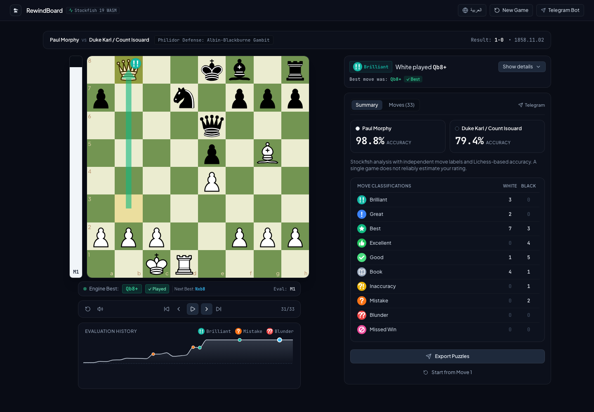
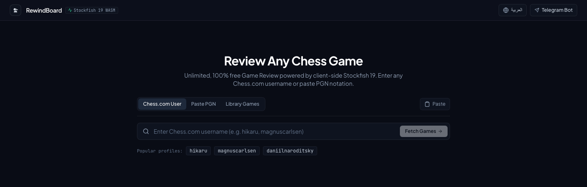
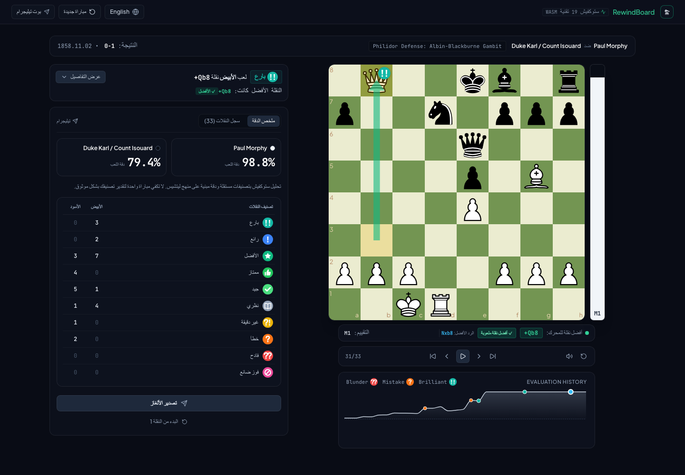

<div align="center">


# RewindBoard

### Every move has a lesson. Rewind yours.

Free chess game review powered by Stockfish 19, right in your browser.<br />
Import a game, uncover turning points, and explore what you could have played.

**No account required · Local engine analysis · English & العربية**

[](https://github.com/Enes830/chessweb/actions/workflows/ci.yml)


[Get started](#quick-start) · [Screenshots](#screenshots) · [How it works](#how-it-works) · [Contribute](#contributing)

</div>



## Why RewindBoard?

Your post-game review should help you understand your decisions—not just tell you that you blundered. RewindBoard combines a local chess engine with move-by-move feedback, alternative lines, and explanations so you can turn a finished game into your next lesson.

The engine runs on your device in Web Workers. You do not need an account or an API key for core game review, and there is no hosted engine service to configure.

## Features

| | What you can do |
| --- | --- |
| **Bring your own games** | Look up a Chess.com username, import a Chess.com or Lichess game URL, paste PGN, or try a built-in classic. |
| **Review with Stockfish 19** | Analyze games at depth 16 with up to two candidate lines and a pool of up to four browser workers. |
| **Find the turning points** | See Brilliant, Great, Best, Excellent, Good, Book, Inaccuracy, Mistake, Blunder, and Missed Win labels. |
| **Understand the position** | Follow engine arrows, the evaluation bar, a clickable evaluation graph, and coaching explanations. |
| **Ask “what if?”** | Play alternative moves on the board and get live engine feedback without changing the original game. |
| **Recognize opening theory** | Identify exact legal positions from a catalog of 7,982 opening positions. |
| **Review in your language** | Switch between English and Arabic with right-to-left layout support. |
| **Practice your mistakes** | Export tactical positions as JSON or send them to a configured Telegram integration. |

## Screenshots

Real screenshots of the app running locally with the built-in **Morphy Opera Game**—no account or private game data needed.

### Import a game

Start with a username, a game link, or your PGN. The built-in library lets you try a review immediately.



### Explore a review

Step through the game, compare your move with the engine recommendation, and inspect accuracy and move classifications.


### Learn in Arabic

The same review workflow, with Arabic translations and a right-to-left interface.



## Quick start

### Requirements

- **Node.js 20.9 or newer** and npm.
- A modern browser with WebAssembly and Web Worker support.

```bash
git clone https://github.com/Enes830/chessweb.git
cd chessweb
npm install
npm run dev
```

Open **http://localhost:3000**, select **Library Games**, and try **Morphy's Opera Game** for a first review. You can also paste a PGN or search for a Chess.com username.

Installation automatically copies the Stockfish JavaScript and WASM files into `public/engine/`. Do not edit those generated engine assets by hand.

### Optional configuration

Core analysis works without environment variables. To configure coaching or Telegram exports:

```bash
cp .env.example .env.local
```

| Variable | Purpose |
| --- | --- |
| `OPENAI_API_KEY` | Enables optional server-side AI coaching. Without it, explanations fall back to local heuristics. Keep this key on the server. |
| `NEXT_PUBLIC_TELEGRAM_BOT_USERNAME` | Telegram bot target; defaults to `RewindChessBot`. |
| `NEXT_PUBLIC_BOT_WEBHOOK_URL` | Optional endpoint for sending puzzle exports. |

Variables prefixed with `NEXT_PUBLIC_` are visible to the browser: never put secrets in them. The companion Telegram bot is a separate integration, not a bot server included in this repository.

### Production

```bash
npm run build
npm start
```

Use a Next.js-compatible host with a Node.js runtime for the game-import and optional coaching API routes. The production build also copies the Stockfish assets. Serve `public/engine/stockfish.wasm` as `application/wasm`; the included Next.js configuration already sets this header.

## How it works

```text
Import game → Replay PGN → Evaluate positions → Classify moves → Explore & practice
                chess.js     Stockfish WASM      Local scoring    Review dashboard
```

1. **Replay:** `chess.js` validates the game and produces the board position before and after each move.
2. **Evaluate:** Stockfish runs in browser Web Workers. Game review uses depth 16; live variation exploration uses depth 14. Terminal positions are handled without an engine search.
3. **Explain:** Local classification uses expected-score loss, exact opening matches, and sacrifice detection. Coaching adds a short explanation of the decision.
4. **Explore:** Navigate the move list or graph, test alternatives, and export useful training positions.

### Transparent scoring, not a platform clone

Accuracy uses Lichess-based formulas. Move classifications use an independent implementation of documented loss bands and tactical checks. They are **not Chess.com CAPS scores**, an exact reproduction of another platform's review, or a calibrated performance Elo estimate. Results depend on search depth and engine behavior.

Read the [analysis methodology](docs/analysis-methodology.md) for formulas, classification thresholds, and engine details.

### What stays local?

- **Engine search and move classification** run on your device. Pasting PGN does not require uploading the game to a hosted chess engine.
- **Online game imports** contact Chess.com or Lichess; URL resolution uses the app's `/api/fetch-game` route.
- **Optional AI coaching**, when configured, sends position and move context through the server to the AI provider.
- **Puzzle exports** are stored in browser `localStorage` (up to 200 items). Sending them through Telegram or a webhook shares them with that destination.
- The app includes **Vercel Analytics**. Local engine analysis does not mean the entire app is network-free or telemetry-free.

## Development

| Command | Purpose |
| --- | --- |
| `npm run dev` | Start the development server. |
| `npm test` | Run deterministic regression tests. |
| `npx tsc --noEmit` | Run strict TypeScript validation. |
| `npm run lint` | Run the current lint script, which is a TypeScript check. |
| `npm run build` | Copy engine assets and create a production build. |
| `npm start` | Serve the production build. |
| `node scripts/update-openings.mjs` | Refresh the opening catalog; requires network access. |

### Project map

```text
src/
├── app/
│   ├── page.tsx                 Import → analysis → review workflow
│   └── api/                     Game resolution and optional AI coaching
├── components/                  Chessboard, importer, coach, graph, and summaries
├── lib/
│   ├── engine/                  Stockfish workers and move classification
│   ├── i18n/                    English / Arabic translations and language context
│   ├── bridge/                  Telegram links and puzzle exports
│   ├── coachExplainer.ts        Local explanations and optional API fallback
│   └── openings.ts              Exact-position opening lookup
└── types/                       Shared chess and puzzle types
tests/                           Analysis regression tests
scripts/                         Engine setup and opening-data maintenance
docs/                            Analysis methodology and README screenshots
```

## Contributing

Bug reports, clearer explanations, accessibility improvements, and analysis regressions are welcome.

1. Open an issue describing the problem or proposed change. For analysis bugs, include a PGN or FEN, the move in question, and what you expected.
2. Fork the repository and keep your changes focused.
3. Run `npm test`, `npx tsc --noEmit`, and `npm run build` before opening a pull request.
4. Describe what changed and include screenshots for UI work.

Please read [AGENTS.md](AGENTS.md) for architecture and project conventions. Add new UI strings to **both English and Arabic** dictionaries, preserve RTL behavior, and keep engine evaluations normalized to White's perspective.

## Acknowledgments

- **Stockfish** supplies the WebAssembly chess engine.
- **chess.js** handles chess rules, PGN replay, and position validation.
- **react-chessboard** provides the interactive board; **Recharts** powers the evaluation graph.
- **lichess-org/chess-openings** supplies the CC0 source data for the opening catalog.
- **Lichess** provides the public accuracy formulas used by the scoring pipeline.
- **Brilliant-Chess** and **WintrCat/freechess** informed the sacrifice-detection implementation.

RewindBoard is an independent project and is not affiliated with Chess.com, Lichess, or the Stockfish team.

## License status

A project-wide license has not yet been added. The maintainer should select and publish one before presenting this repository as a licensed open-source release. Third-party code, engine binaries, and data retain their respective licenses; a public repository does not replace those terms.
